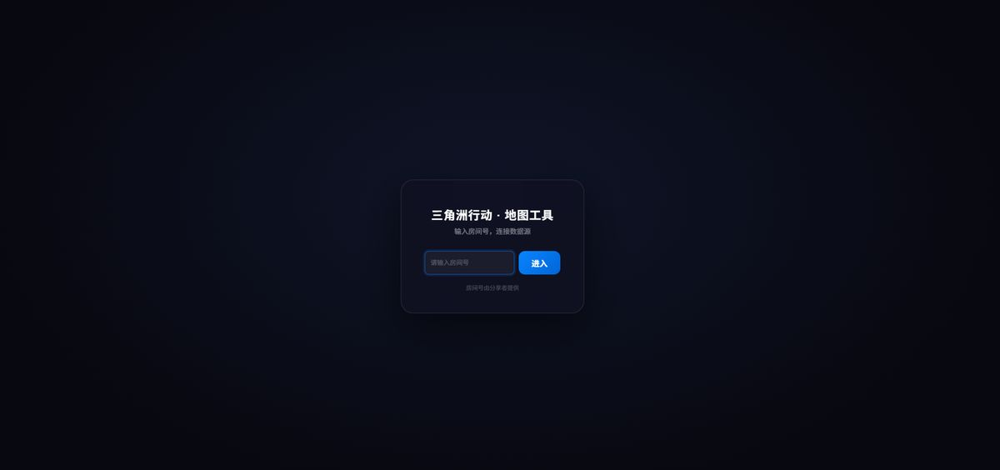
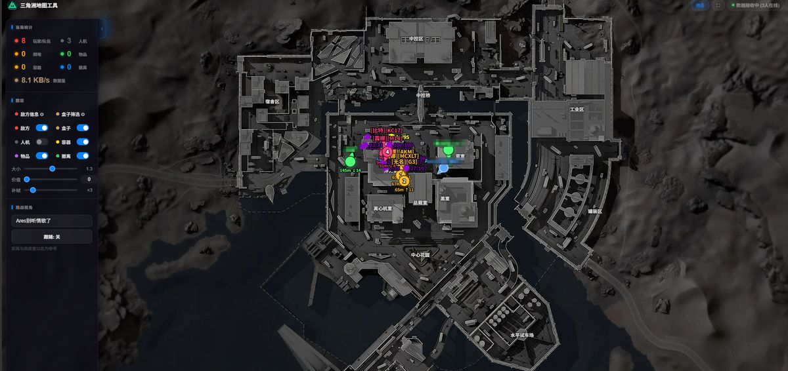
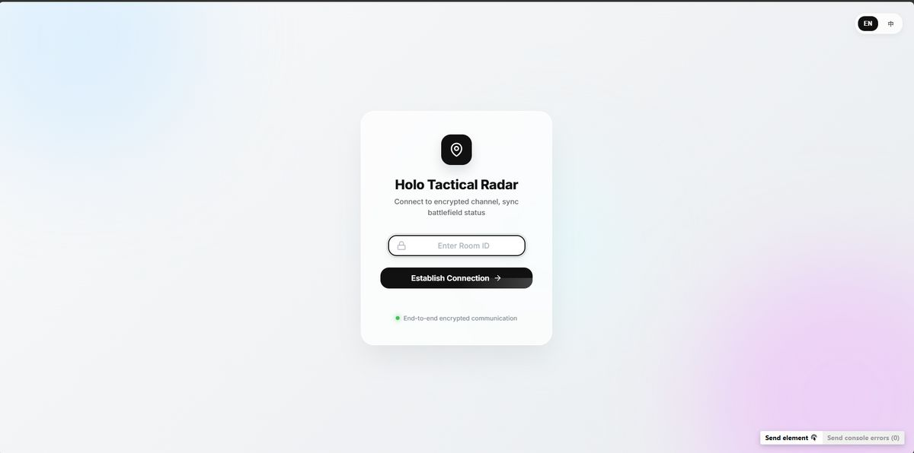
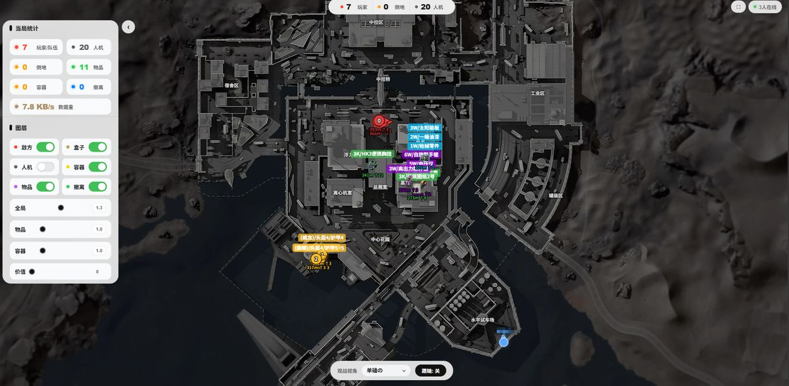
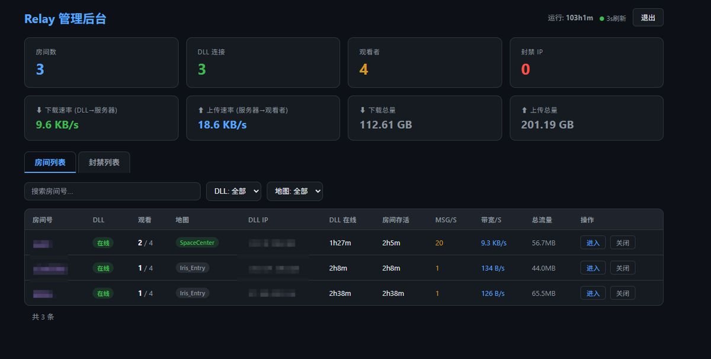
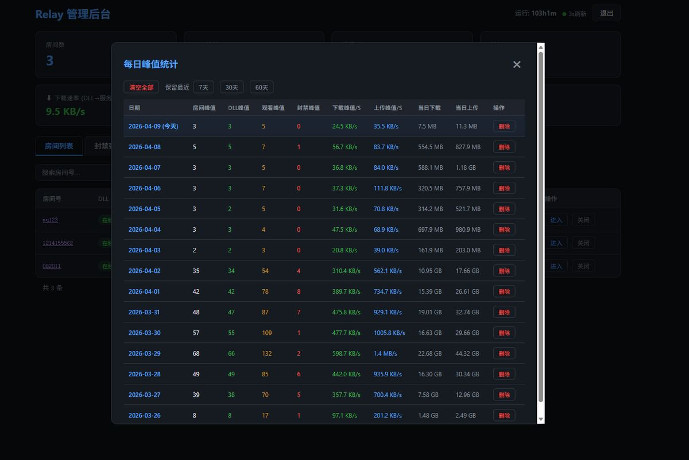

# 🎯 Delta Force Radar — 实时地图工具

《三角洲行动》烽火地带实时互动地图，支持多人观战、WebSocket / UDP 中继转发。

仓库包含 **两个版本并存**：新版 `radar-opensource/`（v1.8.0，后续主线）与旧版 `黑色前端后端/`、`白色前端后端/`（v1，归档保留）。

---

## 🆕 版本说明（2026-11-24）

| 版本 | 目录 | 技术栈 | 状态 |
|:---|:---|:---|:---|
| **v1.8.0（新）** | `radar-opensource/` | Node.js 20+ / PostgreSQL / 模块化后端 | ✅ 推荐，持续维护 |
| v1（旧） | `黑色前端后端/`、`白色前端后端/` | Node.js 18+ / SQLite / 单文件 relay.js | 📦 归档保留 |

新版带来：UDP 二进制输入、录制与回放、公告系统、隐私模式、前端访问控制、外部 API 白名单同步、审计日志、同源网关、完全离线可用；同时**移除了默认口令与第三方 CDN 依赖**。

- 📖 **两版完整对比 + 部署操作 + 联调记录**：[`新版对比与操作指南.md`](新版对比与操作指南.md)
- 🚀 想快速跑起来：看下面的「新版快速开始」
- 📦 想跑旧版：直接跳到文末「旧版（v1，归档）」

> ⚠️ 新版 WS 协议与旧版完全兼容，**旧 DLL 无需修改**即可连接新版后端。

---

## 🚀 新版快速开始（v1.8.0）

### 环境要求

- **Node.js** ≥ 20
- **PostgreSQL** ≥ 13（需自行建库建账号）
- 一台服务器（本机调试亦可）

### 1. 建数据库

```bash
sudo -u postgres psql <<'SQL'
CREATE USER radar WITH PASSWORD '换成你自己的强密码';
CREATE DATABASE radar OWNER radar;
SQL
```

### 2. 安装依赖

```bash
cd radar-opensource
npm --prefix backend ci      # 15 个包，无第三方运行时依赖膨胀
```

### 3. 填写配置

```bash
cp backend/.env.example backend/.env
```

`backend/.env` 必填四项（**不提供任何默认账号密码**，缺任一项会拒绝启动）：

| 配置项 | 说明 |
| --- | --- |
| `ADMIN_USER` | 管理员账号 |
| `ADMIN_PASS` | 管理员密码，**至少 12 位** |
| `ROOMS_SECRET` | 房间名单接口密钥，**至少 32 位**（`openssl rand -hex 24` 生成） |
| `PG_CONN` | PostgreSQL 连接串，如 `postgres://radar:密码@127.0.0.1:5432/radar` |

可选网络配置：

```ini
PORT=5000             # 中继端口（TCP/WebSocket 与 UDP 共用）
ADMIN_PORT=9090       # 管理后台
ADMIN_BIND=127.0.0.1  # 走反代就别暴露公网
FRONTEND_PORT=8080    # 前端静态服务
FRONTEND_BIND=127.0.0.1
TRUST_PROXY=0         # 前面有 Nginx 才设 1
```

### 4. 启动

```bash
# 终端 1：后端（首次启动自动建表、生成 scrypt 密码哈希、创建数据目录）
npm --prefix backend start

# 终端 2：前端
node serve_frontend.js
```

### 5. 访问

| 地址 | 内容 |
| --- | --- |
| `http://127.0.0.1:8080/` | 跟随后台当前主题 |
| `http://127.0.0.1:8080/black/?key=房间号` | 黑色主题 |
| `http://127.0.0.1:8080/white/?key=房间号` | 白色主题（含入场页） |
| `http://127.0.0.1:8080/_black/`、`/_white/` | 主题预览 |
| `http://127.0.0.1:9090/` | 管理后台 |

前端 `/api/*` 与 `/ws` 会自动代理到本机后端，**页面里无需填写服务器地址**。

### 6. 地图资源（可选）

新版**不打包第三方地图图片**。不配置时页面显示坐标、区域与标记回退，且浏览器**零外部请求**。要显示完整地图，编辑 `frontend/config.js`：

```js
tileBase: '你的瓦片地址/{layer}/{z}_{x}_{y}.jpg',
itemIconBase: '你的图标地址/',      // {itemId}.png
markerIconBase: '你的标记地址/',    // bxx / xbxx / dtcld / cgcld
```

### 7. 生产化（Nginx 反代示例）

```nginx
map $http_upgrade $radar_conn { default upgrade; '' close; }

server {
    listen 80;
    server_name 你的域名;
    location / {
        proxy_pass http://127.0.0.1:8080;
        proxy_http_version 1.1;
        proxy_set_header Host $http_host;
        proxy_set_header X-Real-IP $remote_addr;
        proxy_set_header X-Forwarded-For $proxy_add_x_forwarded_for;
        proxy_set_header Upgrade $http_upgrade;
        proxy_set_header Connection $radar_conn;
        proxy_buffering off;
        proxy_read_timeout 300s;
    }
}
```

对外只放行 `5000/tcp`（DLL 连接）与 `5000/udp`（UDP 推流）；**8080 与 9090 不要暴露公网**。

---

## ✨ 新版功能

| 能力 | 说明 |
| --- | --- |
| 实时雷达 | 实体数据实时推送，Leaflet 地图渲染玩家 / 物品 / 容器 / 撤离点 / 盒子 |
| 多人观战 | 一房一 pub，最多 4 个 sub，50ms 节流 |
| **UDP 二进制输入** | RadarBin 协议，比 JSON + zlib 更省带宽（旧 WS 通道仍兼容） |
| **录制与回放** | 整场录制、在线回放、分享 token / 短链 |
| **公告系统** | 4 种类型 × 4 种展示方式（面板 / 弹窗 / 横幅 / Toast） |
| **隐私模式** | 一键隐藏敏感信息 |
| **前端访问控制** | 后台改对外端口，自动生成 / 回滚 Nginx 模板 |
| **外部 API 白名单** | 定时拉取房间名单，未授权房间自动踢出 |
| **审计日志** | 记录后台关键操作 |
| 反滥用 | 认证限流 + 发布限流 + 渐进封禁（0/1m/10m/30m/60m） |
| 完全离线 | Leaflet 1.7.1、ECharts 5.4.3、背景图全部本地，无 CDN |
| 安全默认 | 无默认口令，scrypt 加盐，缺配置拒绝启动 |

> 详细对比（代码量 9.2k → 38.6k 行、接口 11 → 46 个、SQLite 4 表 → PostgreSQL 9 表）见 [`新版对比与操作指南.md`](新版对比与操作指南.md)。

---

## 📸 效果预览

> 以下截图为 **v1 旧版界面**；新版界面已重做（黑白双主题 + 同源网关），截图待补。

### 🖤 暗色主题 (Dark Theme)

| 登录页 | 对局中 |
|:---:|:---:|
|  |  |

### 🤍 浅色主题 (Light Theme)

| 登录页 | 对局中 |
|:---:|:---:|
|  |  |

### 🔧 管理后台 (Admin Dashboard)

| 房间列表 & 实时数据 | 每日峰值统计 |
|:---:|:---:|
|  |  |

---

## 🔌 WebSocket 协议（新旧版通用）

### 连接地址

```
ws://你的服务器IP:5000
```

### 认证（连接后 5 秒内必须发送，否则被踢）

```json
{"action":"auth", "role":"pub", "key":"你的房间号"}    // DLL 端（数据发布者）
{"action":"auth", "role":"sub", "key":"你的房间号"}    // 网页端（观战者）
{"action":"auth", "role":"check", "key":"你的房间号"}  // 仅查询房间是否在线，不占名额
```

认证响应：

```json
{"ok":true, "role":"pub", "subs":2, "pub":true}
{"ok":false, "error":"房间号未授权"}
```

### 转发规则

| 规则 | 说明 |
| --- | --- |
| 每房间 1 个 pub | 新 pub 会顶替旧 pub（WS 与 UDP 可并行） |
| 每房间最多 4 个 sub | 超过返回错误 |
| 必须先发 mapName | 只有匹配已知游戏地图时才转发后续实体数据 |
| 50ms 节流 | 每个 sub 每 50ms 窗口最多收 5 条 |
| pub 限流 | 新版 300 条/秒，旧版 100 条/秒；单条最大 500KB |
| 缓存 | 每种 type 缓存最新一条，新 sub 加入时补发 |
| 压缩 | >64B 且压缩后更小的 JSON 自动 zlib deflate 转发，前端解压 |

### 数据格式

```json
{"type":"mapName", "data":"SpaceCenter_Level_XXX"}
{"type":"self", "data":{"x":12345.0,"y":-9876.5,"z":500.0,"yw":180.5,"map":"SpaceCenter_Level_XXX","n":"玩家名"}}
{"type":"players", "data":[{"x":11000.0,"y":-8000.0,"z":450.0,"h":100,"mh":100,"t":3,"ai":0,"tm":0,"dn":0,"n":"玩家名","yw":90.0,"hl":3,"ar":4}]}
{"type":"items", "data":[{"x":10500.0,"y":-7500.0,"z":400.0,"n":"物品名","oid":"gun/ammo/5.56x45mm","v":15000,"q":4}]}
{"type":"containers", "data":[{"x":10200.0,"y":-7800.0,"z":400.0,"t":1,"o":0}]}
{"type":"exits", "data":[{"x":9000.0,"y":-6000.0,"z":300.0,"s":1}]}
{"type":"boxes", "data":[{"x":10800.0,"y":-7200.0,"z":400.0,"n":"玩家名","ai":0,"bt":1}]}
```

| 字段 | 说明 |
| --- | --- |
| `x, y, z` | UE 坐标（厘米） |
| `yw` | 朝向角度 |
| `h / mh` | 当前 / 最大血量 |
| `t` | 队伍 ID |
| `tm` | 是否队友（1=是） |
| `ai` | 是否人机（1=是） |
| `dn` | 是否倒地（1=是） |
| `hl / ar` | 头盔 / 护甲等级 |
| 容器 `t` | 1=保险箱，2=小保险箱；`o`=已开启 |
| 撤离点 `s` | 1=安全撤离，0=普通 |

有效地图前缀：`Dam_Iris_Level`（零号大坝）、`OLDCITY_LEVEL`（长弓溪谷）、`Forrest_Level`（航天基地）、`SpaceCenter_Level`（太空中心）、`Brakkesh_Level`（巴克什）、`Tide_Level`（潮汐监狱）、`AZ-5_Level`（核电站）、`BombDefusal_Watch`、`BombDefusal_Dock`、`BombDefusal_Mansion`。

### 新版新增：UDP RadarBin

新版支持用 UDP 直接推二进制包，省掉 JSON 与压缩开销：

```
Hdr(44B): magic u32 LE 'RDAR'=0x52414452 | ver u16=1 | type u8 | flags u8 | key[32] | payloadBytes u32 LE
type: 1 Info / 2 MapName / 3 Self / 4 Players / 5 Bots / 6 Items / 7 Containers / 8 Exits / 9 Boxes / 10 Doors
```

解码实现见 `radar-opensource/backend/lib/udp-binary.js`，可直接照抄字段定义。UDP 通道与 WS 通道可同时使用，互不影响。

### 发送策略（DLL 侧参考）

| 数据 | 频率 | 压缩 |
| --- | --- | --- |
| `mapName` | 地图切换时 | 不压缩（文本帧） |
| `self` | 每 100ms | zlib（>64B 且有效时） |
| `players` / `bots` | 每 100ms | zlib |
| `items / containers / exits / boxes / doors` | 每 1.5s（增量，无变化不发） | zlib |

---

## 🧪 测试客户端（ws_test_client.cpp）

仓库根目录附一个 C++ **WebSocket 测试客户端**，可模拟 DLL 端向 Relay 发送假数据，方便调试前端而无需运行游戏。

### 编译

```bash
# MSVC (Visual Studio Developer Command Prompt)
cl /EHsc /O2 /utf-8 /Fe:ws_test_client.exe ws_test_client.cpp /link ws2_32.lib

# MinGW
g++ -O2 -o ws_test_client.exe ws_test_client.cpp -lws2_32
```

### 运行

```
ws_test_client.exe
========================================
  WebSocket 雷达测试客户端
========================================

服务器地址 [127.0.0.1]:    ← 输入 Relay 地址，回车用默认
端口 [5000]:                ← 回车用默认
房间号 [repro]:             ← 与前端连接的房间号一致
```

### 发送的模拟数据

| 数据类型 | 频率 | 内容 |
| --- | --- | --- |
| `mapName` | 启动时一次 | `SpaceCenter_Level_Main`（航天基地） |
| `self` | 每 100ms | 自身位置缓慢随机移动 |
| `players` | 每 100ms | 3 个敌人 + 2 个 AI + 1 个队友 |
| `items` | 每 1.5s | 5 个随机物品 |
| `containers` | 每 1.5s | 2 个保险箱 |
| `exits` | 每 1.5s | 2 个撤离点 |
| `boxes` | 每 1.5s | 1 个死亡盒 |

> 新版兼容该客户端：把 IP 指向新版 Relay 的 `5000` 端口即可，前端立刻能看到移动数据。

---

## ⚠️ 安全提醒

1. **新版无需改默认密码** —— 它没有默认口令，缺 `ADMIN_PASS` 会直接拒绝启动；旧版请务必修改 `.env` 中的 `changeme`。
2. **不要提交 `.env`** —— 两版均已在 `.gitignore` 中排除（含 `data/`、`recordings/`、`*.log`）。
3. **管理后台限制访问** —— 新版默认 `ADMIN_BIND=127.0.0.1`，请通过 Nginx + TLS 反代访问，不要直接暴露 9090。
4. **前面有反代再开 `TRUST_PROXY=1`** —— 否则忽略 `X-Forwarded-For`，防止 IP 伪造绕过封禁。
5. **`ROOMS_SECRET` 要够长** —— 新版强制 ≥32 位。

---

## 📦 旧版（v1，归档）

保留供历史部署参考，**不再新增功能**。

### 项目结构

```
├── 黑色前端后端/              # 暗色主题版本
│   ├── radar_backend/radar-relay/
│   │   ├── relay.js           # 主服务（WS 转发 + 管理后台 API，单文件）
│   │   ├── admin.html         # 管理后台页面
│   │   └── ecosystem.config.js# PM2 配置
│   └── radar_frontend/radar/
│       ├── index.html
│       └── js/                # mapConfig / mapEngine / canvasRenderer / wsClient / ui / main
│
├── 白色前端后端/              # 浅色主题版本（含入场动画、中英双语）
│   └── ... landing.html / map.html / push_rooms.sh
```

### 部署

```bash
cd 黑色前端后端/radar_backend/radar-relay
npm install
cp .env.example .env      # 修改 ADMIN_PASS / ROOMS_SECRET
node relay.js             # 或 pm2 start ecosystem.config.js
```

前端为纯静态文件，任意 Web 服务器托管即可（Nginx 示例）：

```nginx
server {
    listen 1010;
    server_name _;
    root /path/to/radar_frontend/radar;
    index index.html;
    location / { try_files $uri $uri/ /index.html; }
}
```

访问：地图 `http://你的IP:1010/`，管理后台 `http://你的IP:1377/`。

### 环境变量

| 变量 | 默认值 | 说明 |
| --- | --- | --- |
| `PORT` | `5000` | WebSocket 服务端口 |
| `ADMIN_PORT` | `1377` | 管理后台 HTTP 端口 |
| `ADMIN_USER` | `admin` | 管理后台用户名 |
| `ADMIN_PASS` | `changeme` | 管理后台密码（**必须修改**） |
| `ROOMS_API_URL` | 空 | 房间白名单拉取地址（留空用推送模式） |
| `ROOMS_API_BIND` | 空 | 拉取 API 时的出口绑定 IP |
| `ROOMS_SECRET` | `changeme` | 白名单推送接口密钥（**必须修改**） |

### 两套主题区别

| 特性 | 黑色版 | 白色版 |
| --- | --- | --- |
| 主题风格 | 暗色系 | 浅色毛玻璃 |
| 入场页面 | 内嵌 index.html | 独立 landing.html + 白屏转场 |
| 多语言 | 中文 | 中 / 英双语 |
| 房间推送脚本 | 无 | 含 push_rooms.sh |

### 已知差异

- 数据库为 SQLite，**不能直接迁移**到新版 PostgreSQL
- 前端硬编码 `ws://hostname:5000`，并通过 CDN 加载 Leaflet 与图标，离线不可用
- 后台端口 1377（新版 9090）

---

## 📝 License

MIT。第三方组件署名见 `radar-opensource/THIRD_PARTY_NOTICES.md` 与 `radar-opensource/frontend/THIRD_PARTY_NOTICES.md`。
